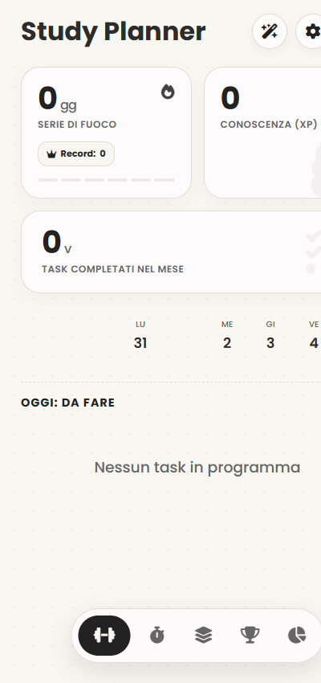
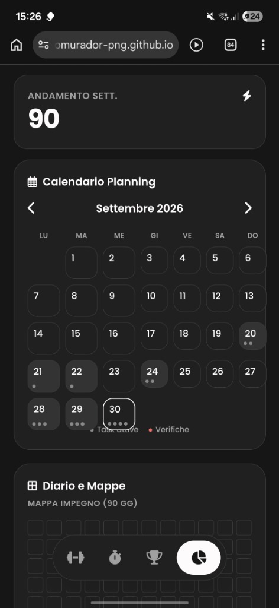

<div align="center">


# Study Planner

Il taccuino digitale per la gestione intelligente dello studio, delle verifiche, del focus profondo e della memorizzazione a lungo termine.

[](https://tommasomurador-png.github.io/StudyPlanner/)
[](LICENSE)
[](https://github.com/tommasomurador-png/StudyPlanner/releases/latest)

<p align="center">
  <a href="https://tommasomurador-png.github.io/StudyPlanner/"><b>Apri la Web App Online</b></a> &bull; <a href="https://github.com/tommasomurador-png/StudyPlanner/releases/latest"><b>Scarica APK Android</b></a>
</p>

</div>

---

## Screenshots

Fai clic su un'immagine per aprirla a piena risoluzione.

<p align="center">
  
  
  
</p>

---

## Perché Study Planner fa la differenza

A differenza delle tradizionali applicazioni per to-do list, Study Planner è progettato appositamente per le reali necessità di studenti e studentesse. Integra pianificazione automatica dei carichi, monitoraggio dell'impegno e statistiche avanzate all'interno di un'unica interfaccia pulita, priva di pubblicità e orientata alla massima privacy locale.

- **Privacy totale e funzionamento offline:** Tutti i dati, i voti, le verifiche e le note rimangono memorizzati unicamente sul dispositivo dell'utente. Non richiede registrazione di account, login remoti né tracciamento pubblicitario.
- **Ripartizione dinamica del carico di lavoro:** Calcola il ritmo ottimale di pagine ed esercizi giorno per giorno fino alla data della prova. Se un giorno studi meno del previsto, l'algoritmo distribuisce automaticamente il carico residuo sulle giornate rimanenti.
- **Gamification e Gradi Accademici:** Punti Conoscenza (XP), Serie di Fuoco continuativa e avanzamento di livello da Matricola fino a Einstein per mantenere alta la motivazione giorno dopo giorno.
- **Statistiche e Analisi Visiva:** Calendario planning con indicatori mensili, grafico a torta Donut con distribuzione per materia e mappa di impegno storico a 90 giorni.

### Piattaforme supportate

- **Web e Progressive Web App (PWA):** Accessibile da qualsiasi browser moderno su computer, tablet e smartphone, installabile sulla schermata iniziale e fruibile senza connessione a Internet.
- **App Android Nativa (.APK):** Con sincronizzazione offline, widget per la schermata home e Web Speech API integrata.

---

## Come installare

### 1. Applicazione Android (.APK)
1. Scarica il file .apk ufficiale dalla sezione **[Releases su GitHub](https://github.com/tommasomurador-png/StudyPlanner/releases/latest)**.
2. Aprilo sul tuo smartphone Android e conferma l'installazione.

### 2. Web App / PWA (Browser)

1. Visita la pagina ufficiale: **[tommasomurador-png.github.io/StudyPlanner](https://tommasomurador-png.github.io/StudyPlanner/)**.
2. Apri il menu del browser (o il pulsante Condividi su iOS / Safari).
3. Seleziona **"Aggiungi a schermata Home"** o **"Installa applicazione"**.

---

## Novità Versione 2.4.0: Split Hotbar e Mentore Vocale Mallow

Basata sul design e sulle specifiche interattive dell'utente:

### 1. Split Hotbar con Animazione a Fusione Morbida
- **Barra Navigazione Divisa in Due Ali:**
  - **Ala Sinistra:** Studio (`#nav-study`) e Calendario (`#nav-calendar`).
  - **Slot Centrale Bot:** Pulsante circolare nero con gli occhi a capsula verticale bianchi di Mallow `(||)` che ammiccano periodicamente.
  - **Ala Destra:** Registro Voti (`#nav-grades`) e Classifica (`#nav-ranked`).
- **Transizione Fluida al Tocco:**
  - Quando si tocca il pulsante del bot, l'icona circolare di Mallow trasla verso l'alto uscendo dalla barra.
  - Contemporaneamente, le due ali scorrono l'una verso l'altra unendosi perfettamente in un'unica capsula continua (`.split-hotbar.is-merged`).
  - Quando si chiude la vista vocale o si tocca una scheda, la barra si ri-separa tornando allo stato iniziale a due ali.

### 2. Schermata Vocale Fullscreen con Mallow Audio-Reattivo
- **Mascotte Vettoriale Mallow:** Mascotte basata su *Open Mascot Studio*, visualizzata in grande al centro con anelli a onde concentriche iridescenti che pulsano durante l'ascolto.
- **Audio-Reattività in Tempo Reale (Web Audio API):**
  - Mallow si ingrandisce e rimpicciolisce in tempo reale (`AnalyserNode`) in base al volume della voce, all'intonazione, alla cadenza del parlato e alle pause ("spazi").
  - Quando l'utente tace o fa una pausa, la mascotte torna dolcemente alla dimensione naturale.

### 3. Workflow Intelligente con Scheda di Invio / Conferma
- **Breve Introduzione Vocale & a Schermo:**
  - Al termine della frase, Mallow introduce con voce sintetizzata naturale e sul fumetto la precisa azione che intende eseguire.
- **Card di Anteprima Azione & Pulsante di Invio:**
  - Compare la scheda con il riepilogo dettagliato dell'operazione e il pulsante **`[ ✓ Conferma ed Esegui ]`** per autorizzare le modifiche.
  - Se l'utente desidera apportare correzioni, basta toccare nuovamente Mallow sullo schermo per parlare e rettificare la richiesta.

### 4. Gestione Vocale a 360° dei Dati
Il bot è in grado di operare sia con parser NLP regex offline a costo zero, sia con Google Gemini Flash:
- **Aggiungere:**
  - *Compiti ed esercizi:* con materia, descrizione e data (es. *"Aggiungi compito di matematica esercizi pag 50 per domani"*).
  - *Verifiche ed interrogazioni:* con numero di pagine, data e suddivisione scientifica dello studio (es. *"Verifica di storia di 30 pagine per venerdì"*).
  - *Voti:* con materia e punteggio (es. *"Ho preso 8 in italiano"*).
- **Togliere / Eliminare:**
  - Rimozione mirata di compiti, verifiche o voti già memorizzati (es. *"Togli compito di matematica"*, *"Cancella il voto di storia"*).
- **Modificare:**
  - Aggiornamento di date, numero di pagine o descrizioni su task esistenti (es. *"Modifica la verifica di storia metti 40 pagine"*, *"Sposta il compito di matematica al 12 novembre"*).

---

## Funzionalità Principali nel Dettaglio

### 1. Pianificazione Scientifica dello Studio (Dunlosky 2013 & Cepeda 2008)
- **Metodo Spaced Practice "Chunk & Cycle":** Suddivisione del carico in base alle scienze cognitive, dedicando il 68-80% dei giorni all'acquisizione e il restante 20-32% al consolidamento spaziato.
- **Micro-Richiamo Attivo (Active Recall):** Ogni blocco giornaliero sollecita 10 minuti di autoverifica attiva sui concetti del giorno prima, contrastando la Curva dell'Oblio di Ebbinghaus.
- **Ricalibrazione Adattiva sui Voti:** Se la media nella materia è insufficiente (< 6), l'algoritmo alleggerisce il carico giornaliero del 25% (per prevenire il sovraccarico cognitivo di Sweller) ed estende il margine di ripasso finale a più giorni.

### 2. Registro Elettronico dei Voti
- **Medie per Materia e GPA Generale:** Calcolo istantaneo della media per ciascuna disciplina e della media ponderata complessiva con indicatori di stato (Eccellente, Sufficiente, A Rischio, Critico).
- **Tipologia e Dettagli:** Tracciamento dei voti per tipologia (Scritto, Orale, Pratico), con data, note dell'argomento e collegamento opzionale alla verifica nel planner.
- **Correlazione Studio-Voto:** Mallow analizza i giorni di studio impiegati e il voto conseguito per ottimizzare continuamente la strategia di studio.

### 3. Gamification e Gradi Accademici
- Meccanismo motivazionale basato su punti Conoscenza (XP) maturati a ogni task completata o voto inserito.
- Serie di Fuoco con tracciamento dei giorni consecutivi di studio sul piano.
- Gradi accademici progressivi da Matricola fino a Einstein con indicatore di progresso live.
- Notifiche locali motivazionali intelligenti per non perdere la serie di studio.

### 4. Statistiche, Calendario e Grafico per Materia
- Calendario mensile con indicatori distinti per verifiche in programma e compiti da completare.
- Grafico Donut vettoriale per osservare la percentuale e il numero di task suddivisi per materia.
- Mappa di impegno continuativo a 90 giorni ispirata ai contributi di GitHub.
- Grafico a barre dell'andamento settimanale con conteggio complessivo degli XP maturati.

### 5. Widget Nativo per Schermata Home Android
- Componente AppWidget nativo sviluppato tramite AppWidgetProvider di Android.
- Monitoraggio in tempo reale del numero di giorni consecutivi di studio (Serie di Fuoco).
- Promemoria sintetico delle task ancora da svolgere nel corso della giornata.
- Accesso immediato con tocco per aprire direttamente la dashboard dell'applicazione.

---

## Architettura del Progetto

```text
StudyPlanner/
|-- app/
|   |-- src/main/
|   |   |-- assets/                 File sorgente web inclusi nell'applicazione nativa
|   |   |-- java/.../
|   |   |   |-- MainActivity.kt     Gestione WebView, navigazione e interfaccia JavaScript
|   |   |   `-- StudyPlannerWidgetProvider.kt   Logica del Widget per la schermata home
|   |   |-- res/
|   |   |   |-- layout/             Layout XML del widget nativo Android
|   |   |   |-- xml/                Metadati di configurazione del widget
|   |   |   `-- values/             Definizione colori, stringhe e stili nativi
|   |   `-- AndroidManifest.xml     Permessi, configurazione receiver e activity
|   `-- build.gradle.kts            Configurazione di compilazione del modulo Android
|-- css/
|   `-- style.css                   Stili modulari, split-hotbar animata e interfaccia Mallow
|-- js/
|   `-- app.js                      Audio-reattività Web Audio, motore Mallow, Dunlosky 2013 e gamification
|-- mallow-pose.svg                 Mascotte Mallow da Open Mascot Studio
|-- screenshots/                    Immagini e anteprime dell'interfaccia
|-- sw.js                           Service Worker per supporto PWA e funzionamento offline
`-- index.html                      Dashboard principale con Registro Voti e overlay vocale
```

---

## Licenza

Distribuito sotto licenza **MIT**. Consulta il file `LICENSE` per ulteriori informazioni.
